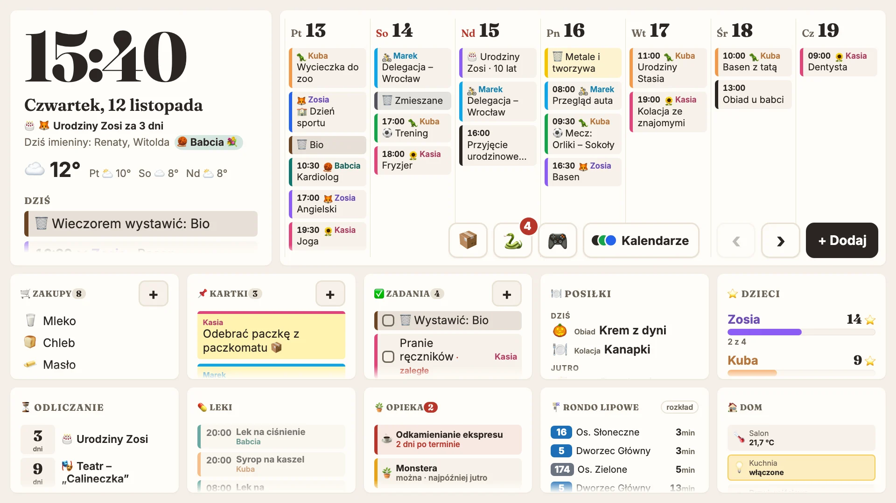
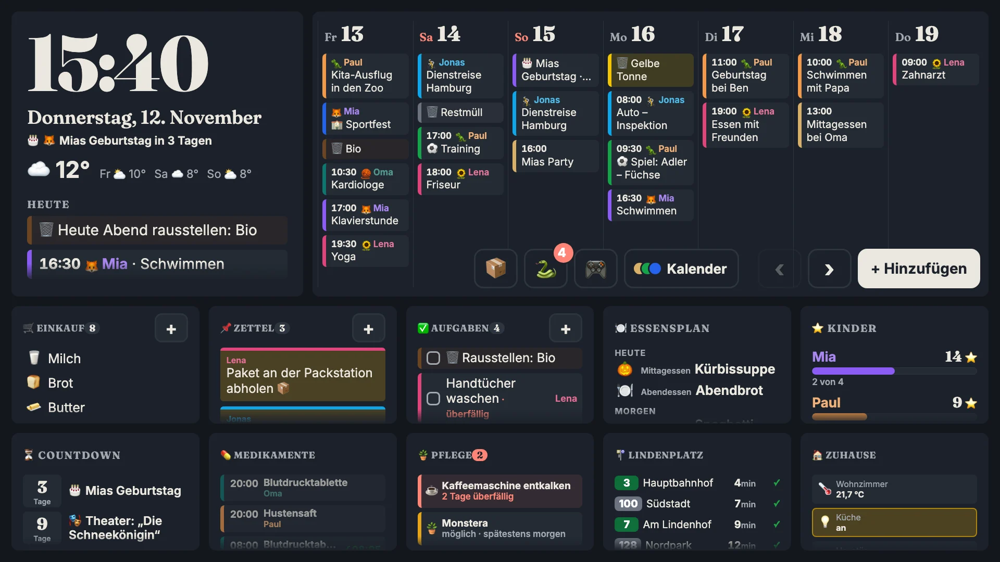
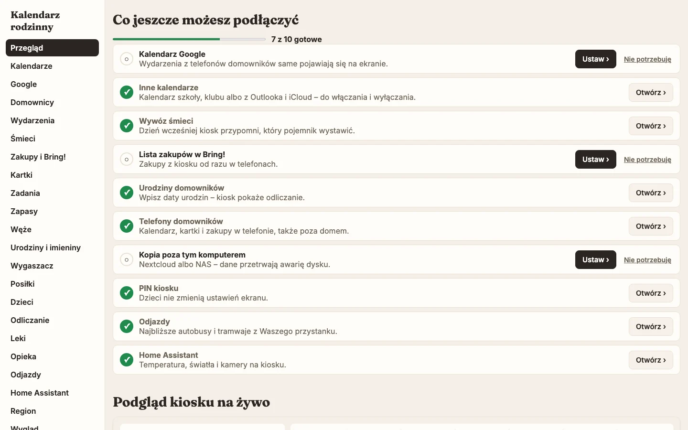
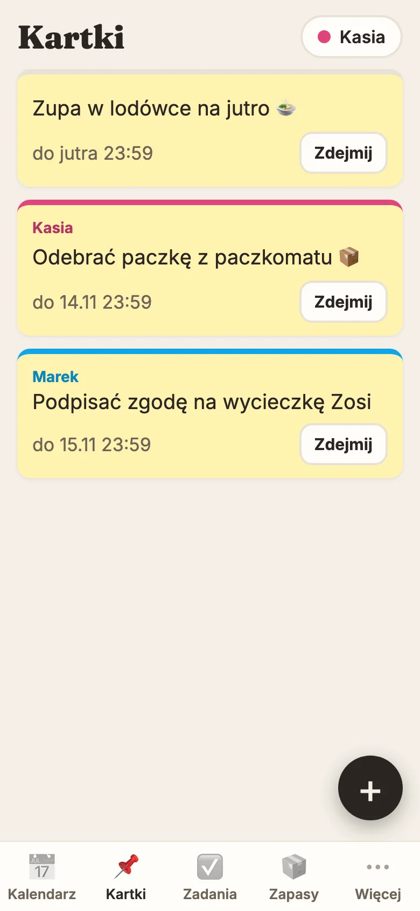
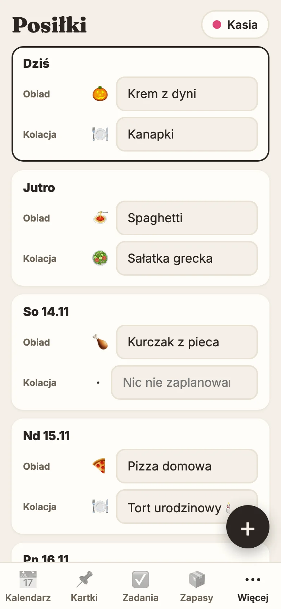
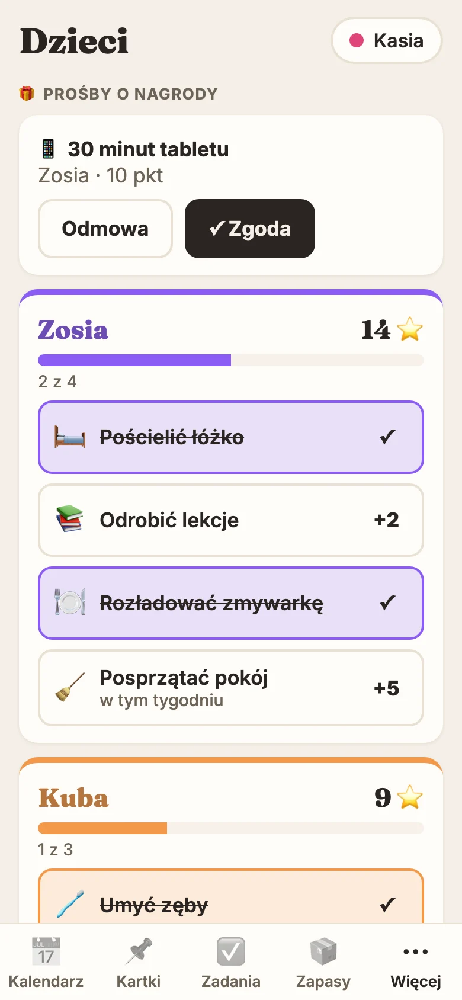

# Kalendarz rodzinny na kiosku dotykowym

[Polski](#polski) | [English](#english)



## Polski

### Co to jest

Kalendarz i tablica domowa na ekranie dotykowym w przedpokoju. Jedna aplikacja SvelteKit z bazą SQLite, uruchamiana w Dockerze na Debianie bez pulpitu. Ekran pokazuje Chromium w trybie kiosku (Cage).

- tydzień i dzisiejszy dzień z kalendarzy Google domowników, zapis nowych wydarzeń z ekranu,
- kalendarze jako warstwy do włączania i wyłączania (panel na stałe, kiosk do północy, telefon dla każdej osoby): Google, wpisy z kiosku, subskrypcje linku iCal (Outlook, iCloud, szkoła, klub), import pliku .ics, urodziny, śmieci, ferie i święta – kolor i ikona per kalendarz: [docs/calendars.md](docs/calendars.md),
- pogoda (Open-Meteo), święta i ferie, wywóz śmieci z pliku iCal,
- kartki (krótkie wiadomości), zadania domowe, lista zakupów (Bring!), zapasy w spiżarni i zamrażarce,
- wersja na telefon (`/telefon`) i panel administracyjny (`/admin`) – przez Tailscale, reverse proxy z logowaniem albo hasło (zobacz [Bezpieczeństwo](#bezpieczeństwo)),
- PIN kiosku: przytrzymanie zegara otwiera ustawienia ekranu (motyw, układ, jasność, wygaszacz, kod QR do panelu), usuwanie na kiosku opcjonalnie po PIN-ie,
- moduły (zakupy, kartki, zadania, śmieci, pogoda, święta, zapasy, węże, plac zabaw, urodziny i imieniny, wygaszacz, plan posiłków, zadania dla dzieci, odliczanie, leki, opieka, odjazdy, Home Assistant – [docs/home-assistant.md](docs/home-assistant.md)) włączane i układane w panelu – opis i dodawanie nowych: [docs/modules.md](docs/modules.md),
- tryb nocny: ekran gaśnie w nocy, dotknięcie go budzi; godziny osobno w tygodniu i w weekend oraz jasność ustawia się w panelu → Ekran,
- profile domowników: awatar (emoji albo zdjęcie), urodziny z odliczaniem, w Polsce dzisiejsze imieniny,
- wygaszacz: pokaz zdjęć rodzinnych po kilku minutach bez dotyku (zdjęcia w `data/media`, są w kopii zapasowej),
- trzy języki interfejsu: polski, niemiecki i angielski (wybór w kreatorze i w panelu → Ustawienia); daty, święta, klawiatura ekranowa i katalog Bring! idą za językiem,
- kopie zapasowe (baza i zdjęcia, opcjonalnie szyfrowane) codziennie albo co tydzień do folderu, udziału NAS i WebDAV/Nextcloud, z rotacją i statusem; przywracanie z panelu → Kopie zapasowe – [docs/backup.md](docs/backup.md).

Repozytorium jest szablonem: dane osobiste zastąpiono przykładowymi. Kod i opisy są po polsku, interfejs jest po polsku, niemiecku albo angielsku.

### Zrzuty ekranu

Dane na zrzutach są fikcyjne (tryb demo, [docs/demo.md](docs/demo.md)). Pozostałe (miesiąc, ekran pionowy i mały, PIN,
wygaszacz, kreator, moduły w panelu): [docs/screenshots](docs/screenshots/README.md).

| | |
| --- | --- |
|  |  |
| Motyw Noc, interfejs po niemiecku (rodzina z Hanoweru) | Panel: przegląd z podglądem kiosku na żywo |

<p>



</p>

Wersja na telefon: kartki, plan posiłków, zadania dzieci z prośbą o nagrodę.

### Tryb demo

`DEMO=1` (i `DEMO_LANG=pl|de|en`) uruchamia aplikację z fikcyjną rodziną z Poznania albo Hanoweru, wszystkimi modułami
i atrapami pogody, odjazdów i Home Assistanta – bez sieci, na osobnej bazie, z resetem przy starcie i co noc. Integracje,
kopie i dostęp są w demo tylko do podglądu, więc nadaje się do publicznego wystawienia. W zwykłej instalacji panel →
Przegląd → „Wczytaj dane przykładowe” dopisuje tę samą rodzinę do istniejących danych. Opis: [docs/demo.md](docs/demo.md).

### Sprzęt

Wystarczy używany komputer typu all-in-one z ekranem dotykowym, x86 i 4–8 GB RAM. Takie urządzenia można kupić z ogłoszeń za ok. 50 €. Do instalacji potrzebna jest zwykła klawiatura USB i pendrive, później tylko prąd i sieć.

### Szybki start

1. Zainstaluj Debian 13 (albo 12) bez środowiska graficznego: w kroku wyboru oprogramowania zaznacz tylko „SSH server” i „standard system utilities”.
2. W BIOS-ie ustaw „Restore on AC Power Loss” na „Power On” (szczegóły w [app/kiosk/README.md](app/kiosk/README.md)).
3. Na urządzeniu:

   ```bash
   sudo apt-get install -y git
   git clone https://github.com/adrian-wulf/wulf-kalendarz-template.git
   cd wulf-kalendarz-template/app
   sudo ./kiosk/install.sh
   sudo reboot
   ```

   Skrypt pyta o użytkownika kiosku (domyślnie `kiosk`), port (domyślnie `3000`), Dockera i Tailscale. Bez pytań: `sudo ./kiosk/install.sh --yes`. Można go uruchamiać ponownie.

4. Opcjonalnie Tailscale (telefony, panel): `sudo tailscale up --hostname=kalendarz`, potem `sudo tailscale serve --bg 3000`. Funnel zostaw wyłączony.

Sama aplikacja bez kiosku (np. na serwerze domowym):

```bash
cd app
cp .env.example .env
docker compose up -d --build
```

Aplikacja słucha tylko na `127.0.0.1:${HOST_PORT}`. Na zewnątrz wystawia ją `tailscale serve`.

Bez Dockera (`npm start`) potrzebny jest Node.js **22.12 lub nowszy** (`--env-file-if-exists` wymaga 22.9, Vite 8 – 22.12; obraz Dockera
używa Node 24). Debian 12/13 ma w repozytorium starszy Node – zainstaluj go z [NodeSource](https://github.com/nodesource/distributions)
(`curl -fsSL https://deb.nodesource.com/setup_24.x | sudo -E bash - && sudo apt-get install -y nodejs`) albo przez
[nvm](https://github.com/nvm-sh/nvm) (`nvm install 24`). Sprawdź: `node -v`.

```bash
cd app
cp .env.example .env
npm ci && npm run build
npm start              # http://127.0.0.1:3000
```

Bez `TRUSTED_ORIGINS` formularze są przyjmowane z `http://localhost:PORT` i `http://127.0.0.1:PORT`; inne adresy (np. tailnet) dopisz
w `TRUSTED_ORIGINS`. `npm start` słucha domyślnie tylko na `127.0.0.1` i ufa nagłówkom loginu oraz traktuje jak kiosk tylko localhost (sieci Dockera
`172.16.0.0/12` są zaufane wyłącznie w obrazie Dockera). **Nie ustawiaj `HOST=0.0.0.0`** bez potrzeby: aplikacja byłaby wtedy dostępna
z całej sieci lokalnej, a w trybie `tailscale` strony kiosku i telefonu nie wymagają logowania. Na zewnątrz wystawiaj ją przez
`tailscale serve` albo reverse proxy (wtedy `TRUSTED_PROXIES` = tylko adres proxy).

Przy pierwszym uruchomieniu (pusta baza) kiosk pokazuje kreator: język, region, miejscowość do pogody, domownicy,
moduły, motyw, układ ekranu i dane przykładowe. Można go przejść na ekranie dotykowym albo z telefonu w tailnecie pod `/setup`.
Ponownie uruchamia go przycisk na stronie głównej panelu. Istniejąca baza (są domownicy) kreatora nie pokazuje.

### Konfiguracja

- `app/.env` (wzór z opisami: [app/.env.example](app/.env.example)): `HOST_PORT`, `ADMIN_LOGINS` (loginy z dostępem do panelu), `TRUSTED_ORIGINS`, `PUBLIC_ORIGIN`, `TZ`, logowanie i token API (`AUTH_MODE`, `API_TOKEN`… – [Bezpieczeństwo](#bezpieczeństwo)). Zmiany działają po `docker compose up -d`, bez ponownego budowania.
- `/etc/kiosk/kiosk.conf` (zapisuje go `install.sh`): `KIOSK_PORT` dla przeglądarki i agenta ekranu. Musi być równy `HOST_PORT`.
- Reszta (domownicy, kalendarze Google, Bring!, plan dnia i nocy, wywóz śmieci) jest w panelu `/admin`. Adres powrotu OAuth do wpisania w Google Cloud panel pokazuje w sekcji Google. Konfiguracja Google Cloud krok po kroku (z publikacją aplikacji i udostępnianiem kalendarzy domowników): [docs/google.md](docs/google.md).

### Bezpieczeństwo

Aplikacja słucha tylko na `127.0.0.1` (Docker: `127.0.0.1:HOST_PORT`). Kto i jak dostaje się dalej, wybiera `AUTH_MODE` w `app/.env`
(wszystkie zmienne z opisem: [app/.env.example](app/.env.example)). Tryb widać w panelu → Dostęp.

| Tryb | Telefon i panel | Kto jest administratorem | Co jest wystawione |
| --- | --- | --- | --- |
| `tailscale` (domyślny) | `tailscale serve` dokleja `Tailscale-User-Login` | `ADMIN_LOGINS` albo każdy w tailnecie | tylko tailnet; strony kiosku i telefonu dla każdego urządzenia w tailnecie, `/api` i panel tylko z loginem |
| `proxy` | reverse proxy loguje i podaje login w nagłówku `AUTH_PROXY_HEADER` (np. `Remote-User` z Authelii, Authentika, Caddy `forward_auth`) | `ADMIN_LOGINS` albo każdy zalogowany | to, co wystawia proxy; bez nagłówka od zaufanego proxy – 401 |
| `password` | strona `/login`, jedno hasło domowe, sesja 30 dni | każdy, kto zna hasło | strona logowania; reszta po zalogowaniu |

- **Kiosk** (Chromium na tym samym komputerze, `http://localhost:PORT`) działa w każdym trybie bez logowania. Kioskiem jest tylko żądanie
  z adresu z `KIOSK_IPS` (domyślnie localhost, w Dockerze także sieci Dockera), z `Host: localhost` i **bez** nagłówków proxy (`X-Forwarded-For`, `Forwarded`,
  `X-Real-IP`, nagłówek loginu). Kiosk nie wchodzi do panelu. Serwer bez ekranu: `KIOSK_LOCAL=0`.
- **Nagłówki loginu** (Tailscale, proxy) liczą się tylko od adresów z `TRUSTED_PROXIES` (domyślnie localhost, w Dockerze także sieci Dockera). Ten sam nagłówek
  z innego adresu jest ignorowany; w trybie `password` nagłówki Tailscale i proxy nic nie dają.
- **`/api/*`**: kiosk, zalogowani (Tailscale, proxy, sesja) albo `Authorization: Bearer <API_TOKEN>`; inaczej 401. Token (co najmniej 24 znaki,
  np. `openssl rand -hex 32`) jest dla skryptów i Home Assistanta, działa tylko na `/api` (nie na stronach i nie w panelu), a zatwierdzić nagrody
  dziecka nim nie można. Przykład: `curl -H "Authorization: Bearer $API_TOKEN" http://127.0.0.1:3000/api/display`. W Home Assistancie
  (`rest_command`) dodaj nagłówek `Authorization: Bearer …`. Inne schematy w `Authorization` (np. `Basic` od proxy) są pomijane. Uwaga: w trybie `tailscale` urządzenia tailnetu bez loginu użytkownika (tagi)
  nie dostaną się do `/api` – potrzebują tokenu.
- **Hasło** (`password`): skrót scrypt z solą – z `.env` (`AUTH_PASSWORD_HASH`, `node server/hash-password.js`) albo ustawiony na `/login`
  kodem z ekranu kiosku (przytrzymaj zegar 2 s; kod jest też w logach serwera i zmienia się przy każdym starcie). Ciasteczko sesji `HttpOnly`,
  `SameSite=Lax`, `Secure` przy https, podpisane HMAC-SHA256 sekretem z `SESSION_SECRET` albo losowym z tabeli `secrets`. Zmiana hasła
  w panelu → Dostęp wylogowuje wszystkie urządzenia. Logowanie: 5 pomyłek z jednego adresu, potem rosnąca przerwa (do 15 min).
- **PIN kiosku** (panel → Dostęp): 4–8 cyfr, zapisany jako skrót scrypt (dawny jawny `settings.pin` jest przy starcie zamieniany na skrót;
  domyślnego 1234 już nie ma – bez ustawienia PIN-u nie ma). Na kiosku przytrzymanie zegara przez 2 s otwiera klawiaturę PIN-u, a po niej
  ustawienia ekranu. 3 pomyłki, potem przerwa od 15 s do 15 min. „PIN przy usuwaniu” wymaga PIN-u przy zdejmowaniu kartek i usuwaniu zapasów
  oraz odliczań na kiosku (sprawdza to też serwer); odhaczanie zakupów i zadań działa jak dotąd, z „Cofnij”. Z ustawionym PIN-em rodzic może
  też zatwierdzić nagrodę dziecka na kiosku.
- **CSRF**: formularze sprawdza SvelteKit (nagłówek `Origin`), dodatkowe adresy w `TRUSTED_ORIGINS`; ciasteczka `SameSite`. Kiosk wysyła JSON.

Model zagrożeń w skrócie:

- Każdy, kto stoi przy ekranie, korzysta z kalendarza (to tablica domowa). PIN chroni ustawienia ekranu i usuwanie, nie dane – kalendarz,
  kartki i listy są widoczne na ekranie.
- Proces na samym komputerze kiosku (localhost) jest traktowany jak kiosk. Kto ma konto na tym komputerze, ma i tak dostęp do bazy.
- `tailscale`: zaufanie do tailnetu – każde urządzenie w tailnecie widzi strony kalendarza. Funnel zostaw wyłączony.
- `tailscale` – nagłówek loginu: `Tailscale-User-Login` przyjmowany jest od adresów z `TRUSTED_PROXIES`, czyli od **każdego procesu na tym
  komputerze** (w Dockerze także od innych kontenerów w sieci Dockera), nie tylko od `tailscale serve`. Taki proces może sam dopisać nagłówek
  i wejść do panelu jako administrator. Z gniazdem tailscaled (`TAILSCALE_WHOIS=auto`, domyślnie: przy `npm start` na hoście z Tailscale
  działa samo, w Dockerze trzeba zamontować `/var/run/tailscale/tailscaled.sock` – przykład w `compose.yaml`) login jest sprawdzany
  w LocalAPI (`whois` adresu tailnetu z `X-Forwarded-For`): wymyślony login albo login niepasujący do adresu nie przejdzie. Nadal przejdzie
  proces, który poda prawdziwy adres urządzenia z tailnetu i login jego właściciela (oba widać w `tailscale status`) – whois zawęża atak,
  ale nie zastępuje zaufania do komputera. Nie uruchamiaj na nim obcego oprogramowania ani obcych kontenerów w tej samej sieci Dockera;
  gdy to konieczne, użyj trybu `password` albo `proxy`. Uwaga: kontener z gniazdem tailscaled działa jako root, a root ma przez LocalAPI
  pełną kontrolę nad Tailscale na hoście.
- `proxy`: bezpieczeństwo zależy od proxy. Proxy musi usuwać nagłówek loginu od klienta i dodawać `X-Forwarded-For`; port aplikacji nie może
  być dostępny z pominięciem proxy, a `TRUSTED_PROXIES` musi wskazywać tylko proxy. nginx domyślnie nie dodaje `X-Forwarded-For` i podaje
  `Host` z `proxy_pass` – dopisz `proxy_set_header Host $host;` i `proxy_set_header X-Forwarded-For $proxy_add_x_forwarded_for;`, inaczej
  żądania przez proxy wyglądałyby jak kiosk.
- `password`: hasło chroni przed obcymi, ale nie rozróżnia domowników (domownika wybiera się na telefonie – zapamiętane w ciasteczku).
  Bez https hasło idzie otwartym tekstem – wystawiaj aplikację tylko za https (Tailscale, Caddy, Traefik).
- Nigdy nie wystawiaj portu aplikacji wprost do sieci (`0.0.0.0` w `compose.yaml`, `HOST=0.0.0.0` przy `npm start`) i nie ustawiaj `ADMIN_DEV=1` poza developmentem.

### Testy

Testy też wymagają Node.js 22.12+.

```bash
cd app
npm ci
npm test               # testy jednostkowe (Vitest)
npm run check          # typy (svelte-check)
npx playwright install chromium
npm run test:e2e       # testy przeglądarkowe (Playwright, buduje aplikację)
npm run screenshots    # zrzuty ekranu do docs/screenshots (dane demo, stały zegar)
```

Lokalnie z panelem bez Tailscale: `ADMIN_DEV=1 npm run dev`. Bez kreatora, z danymi przykładowymi: `SKIP_SETUP=1`.
Gdy port 4173 jest zajęty: `E2E_PORT=4273 npm run test:e2e`. Testy zajmują port bazowy i kolejne: + 2 (kreator, osobny serwer), + 3 (atrapa
wyszukiwarki miejscowości), + 6 (tryb hasła), + 10 (atrapy odjazdów i Home Assistanta), + 20 (kopie zapasowe), + 21 (atrapa WebDAV), + 30 i + 31 (tryb demo).

### Tłumaczenia

Teksty interfejsu są w `app/src/lib/i18n/`: `pl.ts` (źródło), `de.ts` i `en.ts` z tymi samymi kluczami – brakujący klucz to błąd TypeScriptu.
W komponentach `t('klucz', { parametr })`, liczba mnoga przez `tn('klucz', n)`. `npm run i18n:check` sprawdza słowniki i szuka
polskich tekstów wpisanych na sztywno w plikach `.svelte`.

### Licencja

MIT, zobacz [LICENSE](LICENSE).

## English

### What it is

A family calendar and home board on a touch screen in the hallway. One SvelteKit app with a SQLite database, running in Docker on Debian without a desktop. The screen shows Chromium in kiosk mode (Cage).

- week and today from the family members' Google calendars, new events can be added on the screen,
- calendars as layers you switch on and off (admin permanently, kiosk until midnight, phone per person): Google, kiosk entries, iCal link subscriptions (Outlook, iCloud, school, club), .ics file import, birthdays, bins, school and public holidays – colour and icon per calendar: [docs/calendars.md](docs/calendars.md),
- weather (Open-Meteo), public and school holidays, waste collection from an iCal file,
- notes, chores, shopping list (Bring!), pantry and freezer stock,
- a phone view (`/telefon`) and an admin panel (`/admin`) – through Tailscale, a reverse proxy with sign-in, or a password (see [Security](#security)),
- kiosk PIN: holding the clock opens the screen settings (theme, layout, brightness, screensaver, QR code for the panel), deleting on the kiosk optionally needs the PIN,
- modules (shopping, notes, chores, waste, weather, holidays, pantry, snakes, playground, birthdays and name days, screensaver, meal plan, kids' chores, countdown, medication, care, departures, Home Assistant – [docs/home-assistant.md](docs/home-assistant.md)) enabled and ordered in the panel – see [docs/modules.md](docs/modules.md),
- night mode: the screen turns off at night and wakes up on touch; hours (weekdays and weekend separately) and brightness are set in the panel → Screen,
- family member profiles: avatar (emoji or photo), birthdays with a countdown, today's name days in Poland,
- screensaver: a slideshow of family photos after a few idle minutes (photos in `data/media`, included in backups),
- three UI languages: Polish, German and English (chosen in the setup wizard and in the panel → Settings); dates, holidays, the on-screen keyboard and the Bring! catalogue follow the language,
- backups (database and photos, optionally encrypted) daily or weekly to a folder, a NAS share and WebDAV/Nextcloud, with retention and status; restore from the panel → Backups – see [docs/backup.md](docs/backup.md).

This repository is a template: personal data was replaced with demo data. The code comments are in Polish; the UI is available in Polish, German and English.

### Screenshots

The data is made up (demo mode, [docs/demo.md](docs/demo.md)). More (month, portrait and small screens, PIN pad, screensaver,
wizard, panel modules): [docs/screenshots](docs/screenshots/README.md).

| | |
| --- | --- |
|  |  |
| Noc theme, German UI (a family in Hannover) | Panel overview with a live kiosk preview |

<p>


</p>

The phone view: notes, meal plan, kids' chores with a reward request.

### Demo mode

`DEMO=1` (and `DEMO_LANG=pl|de|en`) starts the app with a made-up family from Poznań or Hannover, all modules and fake
weather, departures and Home Assistant – no network, a separate database, reset on start and nightly. Integrations, backups
and access are view-only in the demo, so it can be hosted publicly. In a normal install, panel → Overview → "Load example
data" adds the same family to your existing data. Details: [docs/demo.md](docs/demo.md).

### Hardware

A used all-in-one PC with a touch screen, x86 and 4–8 GB RAM is enough. They sell on classifieds for about 50 €. You need a plain USB keyboard and a USB stick for the install, afterwards only power and network.

### Quick start

1. Install Debian 13 (or 12) without a desktop: in the software selection pick only "SSH server" and "standard system utilities".
2. In the BIOS set "Restore on AC Power Loss" to "Power On" (details in [app/kiosk/README.md](app/kiosk/README.md)).
3. On the device:

   ```bash
   sudo apt-get install -y git
   git clone https://github.com/adrian-wulf/wulf-kalendarz-template.git
   cd wulf-kalendarz-template/app
   sudo ./kiosk/install.sh
   sudo reboot
   ```

   The script asks for the kiosk user (default `kiosk`), the port (default `3000`), Docker and Tailscale. Without questions: `sudo ./kiosk/install.sh --yes`. It is safe to run again.

4. Optional Tailscale (phones, panel): `sudo tailscale up --hostname=kalendarz`, then `sudo tailscale serve --bg 3000`. Keep Funnel off.

The app alone, without the kiosk (for example on a home server):

```bash
cd app
cp .env.example .env
docker compose up -d --build
```

The app listens on `127.0.0.1:${HOST_PORT}` only. `tailscale serve` exposes it to your tailnet.

Without Docker (`npm start`) you need Node.js **22.12 or newer** (`--env-file-if-exists` needs 22.9, Vite 8 needs 22.12; the Docker image
uses Node 24). Debian 12/13 ships an older Node – install it from [NodeSource](https://github.com/nodesource/distributions)
(`curl -fsSL https://deb.nodesource.com/setup_24.x | sudo -E bash - && sudo apt-get install -y nodejs`) or with
[nvm](https://github.com/nvm-sh/nvm) (`nvm install 24`). Check with `node -v`.

```bash
cd app
cp .env.example .env
npm ci && npm run build
npm start              # http://127.0.0.1:3000
```

Without `TRUSTED_ORIGINS`, form posts are accepted from `http://localhost:PORT` and `http://127.0.0.1:PORT`; add other addresses (e.g.
your tailnet) to `TRUSTED_ORIGINS`. `npm start` listens on `127.0.0.1` only by default, and trusts login headers and the kiosk exception from localhost only (the Docker
networks `172.16.0.0/12` are trusted only inside the Docker image). **Do not set `HOST=0.0.0.0`** unless you must: the app would be
reachable from your whole LAN, and in `tailscale` mode the kiosk and phone pages need no sign-in. Expose it through `tailscale serve`
or a reverse proxy (then set `TRUSTED_PROXIES` to the proxy address only).

On first start (empty database) the kiosk shows a setup wizard: language, region, town for the weather, family members,
modules, theme, screen layout and example data. It works on the touch screen and from a phone in the tailnet at `/setup`. The panel's
overview page can run it again. An existing database (with family members) never shows it.

### Configuration

- `app/.env` (template with comments: [app/.env.example](app/.env.example)): `HOST_PORT`, `ADMIN_LOGINS` (logins allowed into the panel), `TRUSTED_ORIGINS`, `PUBLIC_ORIGIN`, `TZ`, sign-in and the API token (`AUTH_MODE`, `API_TOKEN`… – [Security](#security)). Changes apply with `docker compose up -d`, no rebuild needed.
- `/etc/kiosk/kiosk.conf` (written by `install.sh`): `KIOSK_PORT` for the browser and the screen agent. Must equal `HOST_PORT`.
- Everything else (family members, Google calendars, Bring!, day and night schedule, waste collection) is set in `/admin`. The panel shows the OAuth redirect URI to enter in Google Cloud in its Google section. Step-by-step Google Cloud setup (including publishing the app and sharing family members' calendars): [docs/google.md](docs/google.md).

### Security

The app listens on `127.0.0.1` only (Docker: `127.0.0.1:HOST_PORT`). Who gets in beyond that is chosen by `AUTH_MODE` in `app/.env`
(all variables with comments: [app/.env.example](app/.env.example)). The panel → Access shows the active mode.

| Mode | Phone and panel | Who is an admin | What is exposed |
| --- | --- | --- | --- |
| `tailscale` (default) | `tailscale serve` adds `Tailscale-User-Login` | `ADMIN_LOGINS`, or anyone in the tailnet | the tailnet only; kiosk and phone pages for every tailnet device, `/api` and the panel only with a login |
| `proxy` | your reverse proxy signs users in and passes the login in `AUTH_PROXY_HEADER` (e.g. `Remote-User` from Authelia, Authentik, Caddy `forward_auth`) | `ADMIN_LOGINS`, or anyone signed in | whatever the proxy exposes; without the header from a trusted proxy – 401 |
| `password` | a `/login` page, one household password, 30-day session | anyone who knows the password | the sign-in page; everything else after signing in |

- **Kiosk** (Chromium on the same computer, `http://localhost:PORT`) works without sign-in in every mode. A request is the kiosk only when it
  comes from an address in `KIOSK_IPS` (default: localhost, in Docker also the Docker networks), with `Host: localhost` and **without** proxy headers
  (`X-Forwarded-For`, `Forwarded`, `X-Real-IP`, the login header). The kiosk never gets into the panel. Server without a screen: `KIOSK_LOCAL=0`.
- **Login headers** (Tailscale, proxy) count only from addresses in `TRUSTED_PROXIES` (default: localhost, in Docker also the Docker networks). The same header
  from anywhere else is ignored; in `password` mode Tailscale and proxy headers do nothing.
- **`/api/*`**: the kiosk, signed-in users (Tailscale, proxy, session) or `Authorization: Bearer <API_TOKEN>`; otherwise 401. The token (24+
  characters, e.g. `openssl rand -hex 32`) is meant for scripts and Home Assistant, works on `/api` only (not on pages or in the panel), and
  cannot approve a child's reward. Example: `curl -H "Authorization: Bearer $API_TOKEN" http://127.0.0.1:3000/api/display`. In Home Assistant
  (`rest_command`) add an `Authorization: Bearer …` header. Other `Authorization` schemes (e.g. `Basic` from a proxy) are ignored. Note: in `tailscale` mode tailnet devices without a user login (tagged devices)
  cannot reach `/api` – they need the token.
- **Password** (`password`): a salted scrypt hash – from `.env` (`AUTH_PASSWORD_HASH`, `node server/hash-password.js`) or set on `/login` with the
  code shown on the kiosk (hold the clock for 2 s; the code is also in the server log and changes on every start). The session cookie is
  `HttpOnly`, `SameSite=Lax`, `Secure` over https, signed with HMAC-SHA256 using `SESSION_SECRET` or a random secret in the `secrets` table.
  Changing the password in the panel → Access signs out every device. Sign-in: 5 mistakes per address, then a growing pause (up to 15 min).
- **Kiosk PIN** (panel → Access): 4–8 digits, stored as a scrypt hash (an old plain `settings.pin` is hashed on start; the default 1234 is gone –
  no PIN unless you set one). On the kiosk, holding the clock for 2 s opens the PIN pad and then the screen settings. 3 mistakes, then a pause
  from 15 s up to 15 min. "PIN for deleting" asks for the PIN when taking down notes and deleting pantry items and countdowns on the kiosk
  (the server checks it too); ticking off shopping and chores works as before, with Undo. With a PIN set, a parent can also approve a child's
  reward on the kiosk.
- **CSRF**: SvelteKit checks the `Origin` of form posts, extra origins go in `TRUSTED_ORIGINS`; cookies are `SameSite`. The kiosk sends JSON.

Threat model in short:

- Anyone standing at the screen uses the calendar (it is a household board). The PIN protects the screen settings and deleting, not the data –
  calendar, notes and lists are on the screen anyway.
- A process on the kiosk computer itself (localhost) counts as the kiosk. Anyone with an account on that computer can read the database anyway.
- `tailscale`: you trust your tailnet – every device in it sees the calendar pages. Keep Funnel off.
- `tailscale` – the login header: `Tailscale-User-Login` is accepted from addresses in `TRUSTED_PROXIES`, i.e. from **any process on this
  computer** (in Docker also other containers on the Docker network), not only from `tailscale serve`. Such a process can add the header
  itself and enter the panel as an admin. With the tailscaled socket (`TAILSCALE_WHOIS=auto`, the default: works by itself with `npm start` on
  a host running Tailscale; in Docker mount `/var/run/tailscale/tailscaled.sock` – see `compose.yaml`) the login is checked against the
  LocalAPI (`whois` of the tailnet address in `X-Forwarded-For`): an invented login, or one that does not match the address, is rejected.
  A process that sends a real tailnet device address together with its owner's login (both visible in `tailscale status`) still gets in –
  whois narrows the attack but does not replace trusting the computer. Do not run untrusted software on it or untrusted containers on the
  same Docker network; if you must, use `password` or `proxy` mode. Note: a container with the tailscaled socket runs as root, and root has
  full control over the host's Tailscale through the LocalAPI.
- `proxy`: security depends on the proxy. It must strip the login header sent by clients and add `X-Forwarded-For`; the app port must not be
  reachable around the proxy, and `TRUSTED_PROXIES` must list only the proxy. nginx does not add `X-Forwarded-For` by default and sends the
  `proxy_pass` host – add `proxy_set_header Host $host;` and `proxy_set_header X-Forwarded-For $proxy_add_x_forwarded_for;`, otherwise
  proxied requests would look like the kiosk.
- `password`: the password keeps strangers out but does not tell family members apart (each phone picks its member once – stored in a cookie).
  Without https the password travels in clear text – expose the app only behind https (Tailscale, Caddy, Traefik).
- Never publish the app port directly (`0.0.0.0` in `compose.yaml`, `HOST=0.0.0.0` with `npm start`) and never set `ADMIN_DEV=1` outside development.

### Tests

Tests need Node.js 22.12+ too.

```bash
cd app
npm ci
npm test               # unit tests (Vitest)
npm run check          # types (svelte-check)
npx playwright install chromium
npm run test:e2e       # browser tests (Playwright, builds the app)
npm run screenshots    # screenshots into docs/screenshots (demo data, fixed clock)
```

Locally with the panel and without Tailscale: `ADMIN_DEV=1 npm run dev`. Skip the wizard and start with example data: `SKIP_SETUP=1`.
If port 4173 is taken: `E2E_PORT=4273 npm run test:e2e`. The tests use the base port and: + 2 (wizard, separate server), + 3 (town search
mock), + 6 (password mode), + 10 (departures and Home Assistant mocks), + 20 (backups), + 21 (WebDAV mock), + 30 and + 31 (demo mode).

### Translations

UI texts live in `app/src/lib/i18n/`: `pl.ts` (source), `de.ts` and `en.ts` with the same keys – a missing key is a TypeScript error.
Components use `t('key', { param })`, plurals `tn('key', n)`. `npm run i18n:check` checks the dictionaries and looks for
Polish text hard-coded in `.svelte` files.

### License

MIT, see [LICENSE](LICENSE).
