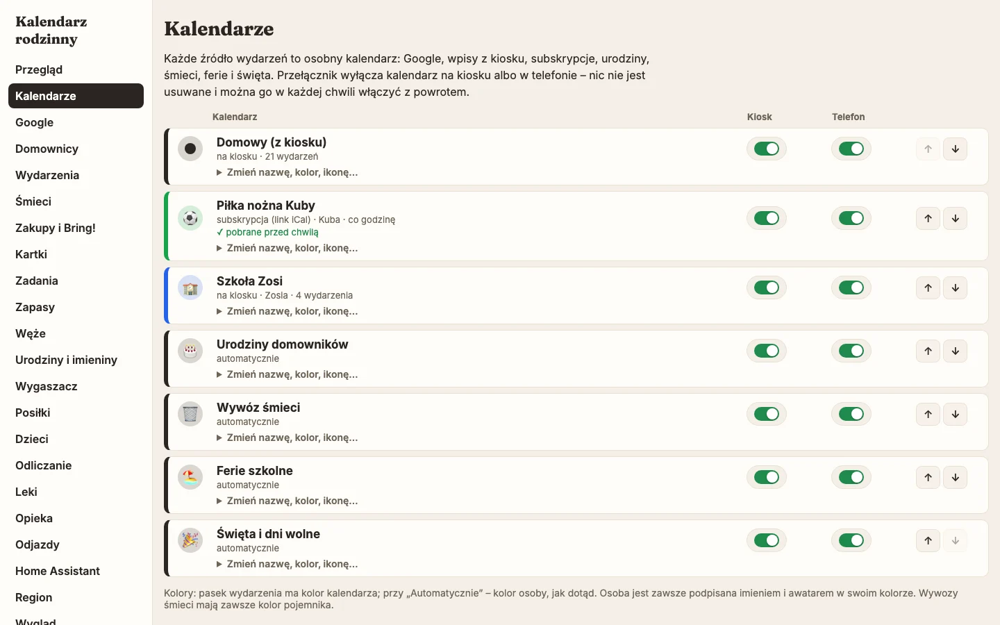

# Kalendarze – warstwy, subskrypcje i import

[English below](#calendars--layers-subscriptions-and-import)

Każde źródło wydarzeń jest osobnym **kalendarzem** (warstwą). Każdy kalendarz ma nazwę, kolor, ikonę (emoji),
opcjonalnie domownika, widoczność na kiosku, widoczność na telefonach i miejsce na liście. Ustawia się to w panelu
→ **Kalendarze**.

| kalendarz | skąd | uwagi |
| --- | --- | --- |
| Google – „Rodzina”, „Kita”, „Urodziny” i kalendarze domowników | panel → Google (konto rodzinne, role) | odczyt co minutę, kiosk zapisuje do „Rodzina”; domownik z przypisania w Google |
| **Domowy (z kiosku)** | wydarzenia dodane na kiosku i w panelu, gdy Google nie jest podłączone | zawsze jest |
| **Subskrypcja (link iCal)** | publiczny/tajny link `.ics` / `webcal://` (Outlook.com, iCloud, Google, szkoła, klub, liga) | tylko odczyt, odświeżanie co 15 min, 1 h, 6 h albo raz dziennie |
| **Zaimportowany** | jednorazowy import pliku `.ics` do lokalnego kalendarza | bez duplikatów (UID), można edytować w panelu → Wydarzenia |
| Urodziny domowników, Wywóz śmieci, Ferie szkolne, Święta i dni wolne | generowane przez moduły | są, gdy moduł jest włączony |

„Kartki” z Google to nie wydarzenia – nie mają warstwy.

## Widoczność

- **Panel → Kalendarze** – przełączniki „Kiosk” i „Telefon” działają od razu i **na stałe**. Nic nie jest usuwane.
- **Kiosk → przycisk „Kalendarze”** (obok strzałek tygodnia, w układzie miesiąca obok „+ Dodaj”) – dotknięcie kalendarza
  ukrywa go **do północy** (np. kalendarz pracy w weekend), drugie dotknięcie albo „Pokaż wszystkie” przywraca.
  Liczba na przycisku = ile kalendarzy jest ukrytych dziś. Bez PIN-u – chyba że w panelu zaznaczysz
  „Blokuj przełączanie na kiosku” (wtedy po PIN-ie; bez ustawionego PIN-u przełączanie jest wyłączone).
  Kalendarzy ukrytych na stałe kiosk nie pokazuje na liście (tylko liczbę).
- **Telefon → Kalendarz** – najbliższe 2 tygodnie i „Moje kalendarze”: każdy domownik wybiera, co widzi u siebie
  (zapis przy osobie na serwerze; bez wybranej osoby – tylko na tym telefonie).
- Ukryte **Święta i dni wolne** = brak nazw świąt w nagłówkach dni (tydzień, miesiąc, dziś).
- Ukryty **Wywóz śmieci** chowa terminy w kalendarzu; zadanie „Wystaw pojemnik” na kafelku Zadania zostaje.

## Kolory – zasada

1. **Wywóz śmieci** – zawsze kolor pojemnika (żółty worek jest żółty), kolor kalendarza tylko w legendzie.
2. Kalendarz z **własnym kolorem** – pasek po lewej stronie wydarzenia ma kolor kalendarza.
3. Kalendarz **„Automatycznie”** (domyślnie – także po aktualizacji) – jak dotąd: kolor osoby, a bez osoby akcent motywu.
4. **Osoba** jest zawsze widoczna osobno: awatar i imię w jej kolorze (także przy kalendarzu z własnym kolorem).

Wydarzenie bez osoby w kalendarzu z przypisanym domownikiem (np. subskrypcja klubu → Kuba) dostaje tego domownika.
Ikona kalendarza stoi przed tytułem (domyślnie: 🎂 urodziny, 🗑 śmieci, 🏖 ferie; pozostałe bez ikony).

## Subskrypcja (link iCal)

Panel → Kalendarze → **Subskrypcja (link iCal)**: wklej link, nadaj nazwę, wybierz osobę, kolor i ikonę →
**Sprawdź link i dodaj**. Link jest pobierany od razu – błąd widać przy formularzu („to jest adres strony, nie
kalendarza”, „kalendarz jest prywatny”, 404…). Rozwijana instrukcja przy formularzu: Google, Outlook.com, iCloud,
szkoła / klub (PL/DE/EN).

- Gdzie jest link: Google – Ustawienia kalendarza → „Integracja kalendarza” → „Tajny adres w formacie iCal”;
  Outlook.com – Ustawienia → Kalendarz → Kalendarze udostępnione → „Publikuj kalendarz” → link ICS;
  iCloud – iPhone → Kalendarz → ⓘ → „Kalendarz publiczny” → „Udostępnij łącze”.
- Parser obsługuje `RRULE` (DAILY/WEEKLY/MONTHLY/YEARLY, BYDAY, BYMONTHDAY, BYMONTH, COUNT, UNTIL), `EXDATE`,
  `RECURRENCE-ID`, `DTEND`/`DURATION`, `TZID` (IANA, nazwy z Outlooka, np. „W. Europe Standard Time”), `LOCATION`.
  Pamięć podręczna trzyma okno od wczoraj do +60 dni. Gdy źródło chwilowo nie działa, zostają ostatnie dane, a panel
  pokazuje błąd.
- **Bezpieczeństwo (SSRF)**: tylko `http(s)` (`webcal://` = `https://`), bez loginu w adresie, adres musi wskazywać
  publiczny internet – pętla zwrotna, sieci prywatne, link-local (metadane chmury), CGNAT/Tailscale i multicast są
  blokowane, także po przekierowaniu (każdy skok sprawdzany, najwyżej 5). Limit 5 MB i 15 s, odpowiedź musi zawierać
  `BEGIN:VCALENDAR`. Kalendarz w sieci domowej (np. Nextcloud na NAS-ie): `ICAL_ALLOW_PRIVATE=1` w `app/.env`.
  Ograniczenie: sprawdzenie DNS i połączenie to dwa osobne zapytania (teoretyczny DNS rebinding) – wymagałoby
  własnego dispatchera undici.

## Import pliku .ics

Panel → Kalendarze → **Import pliku .ics**: krok 1 – wybór pliku i **Sprawdź plik**; krok 2 – podgląd (ile wydarzeń,
od kiedy do kiedy, ile się powtarza, ile pominiętych – minione i nieczytelne, pierwsze pozycje), wybór kalendarza
(nowy – nazwa z `X-WR-CALNAME` pliku – albo istniejący lokalny) → **Importuj**.

- Import tylko od dziś; reguły powtarzania bez końca rozpisane na 2 lata; najwyżej 3000 wydarzeń z pliku.
- **Bez duplikatów**: ten sam UID w tym samym kalendarzu = aktualizacja (tytuł, godziny, miejsce). Podgląd mówi,
  ile wydarzeń już jest w wybranym kalendarzu.
- Plik czeka na „Importuj” 30 minut w pamięci serwera.
- Usunięcie zaimportowanego kalendarza usuwa jego wydarzenia.

## Google: konto rodzinne

Skrót z [docs/google.md](google.md) (jest też w panelu → Kalendarze → „Jak działa konto rodzinne…”): jedno konto Google
dla domu; na nim kalendarze „Rodzina” i „Kartki”; domownicy udostępniają mu swoje kalendarze („Wyświetlanie wszystkich
szczegółów” albo „Wprowadzanie zmian”); w panelu → Google przypisujesz kalendarz do osoby – pojawia się w Kalendarzach
jako jej kalendarz. Google: co minutę i zapis z kiosku; subskrypcja: tylko odczyt; import: jednorazowo.

## Aktualizacja istniejącej instalacji

Migracja `0009_calendar_layers` dodaje tabelę `calendars` i kolumny `calendar_id` (domyślnie `local`), `uid`,
`location`, `description` w `local_events`. Tabela `calendars` przechowuje tylko zmiany użytkownika – po aktualizacji
jest pusta, więc **wszystko zostaje widoczne, a kolory są jak dotąd** („Automatycznie”). Kolejność domyślna: Google
(Rodzina, domownicy, Kita, Urodziny), Domowy, subskrypcje, zaimportowane, urodziny, śmieci, ferie, święta; po pierwszym
przesunięciu ↑/↓ kolejność zapisuje się jawnie.

## Dane i API

- `settings`: `calendarHiddenToday` (`{ date, ids }` – ukryte na kiosku do północy), `calendarLock`,
  `calendarPhoneHidden` (`{ [memberId]: ids[] }`), `googleCalendarNames` (nazwy z Google do nazw domyślnych).
- `POST /api/calendars` (tylko kiosk) `{ id, hidden }` albo `{ all: true }`; `POST /api/calendars/phone`
  `{ memberId, hidden: [...] }`.
- Kod: `lib/calendars.ts` (typy, zasada kolorów), `lib/server/calendars.ts` (rozpoznanie warstw, widoczność),
  `lib/server/sources/subscription.ts` (pobieranie, SSRF, strefy), `lib/server/ics-import.ts`.
- Demo (`DEMO=1`): subskrypcja klubu z atrapy `https://kalendarze.demo.invalid/klub-<lang>.ics` (RRULE + TZID)
  i lokalny kalendarz szkoły.

## Czego nie ma: CalDAV

CalDAV (Nextcloud, iCloud, mailbox.org) nie jest obsługiwany. Ocena:

- **Odczyt** (PROPFIND → `current-user-principal` → `calendar-home-set` → lista kalendarzy, `REPORT calendar-query`
  z zakresem czasu, parsowanie odpowiedzi XML `multistatus` bez nowej zależności, Basic auth z hasłem aplikacji,
  sekret w tabeli `secrets`, testy z atrapą serwera): ok. **2 dni**.
- **Zapis** z kiosku (PUT/DELETE z ETag, konflikty, wybór kalendarza docelowego): kolejne **1–2 dni**.
- iCloud: hasło aplikacji, odkrywanie przez `caldav.icloud.com`, przekierowania na partycje `pXX` – dodatkowe pół dnia
  i trudne testy bez konta.

Do czasu CalDAV: Nextcloud ma link eksportu udostępnionego kalendarza (`…/remote.php/dav/public-calendars/<token>?export`),
iCloud – „Kalendarz publiczny”; oba działają jako **subskrypcja** (Nextcloud w sieci domowej z `ICAL_ALLOW_PRIVATE=1`).

---

# Calendars – layers, subscriptions and import

Every source of events is its own **calendar** (layer) with a name, colour, icon (emoji), optional family member,
visibility on the kiosk, visibility on phones and a position in the list. Set it up in the admin → **Calendars**.

| calendar | source | notes |
| --- | --- | --- |
| Google – "Family", "Nursery", "Birthdays" and family members' calendars | admin → Google (family account, roles) | read every minute, the kiosk writes to "Family"; member from the Google assignment |
| **Home (kiosk)** | events added on the kiosk and in the admin while Google isn't connected | always there |
| **Subscription (iCal link)** | public/secret `.ics` / `webcal://` link (Outlook.com, iCloud, Google, school, club, league) | read-only, refreshed every 15 min, 1 h, 6 h or once a day |
| **Imported** | one-off import of an `.ics` file into a local calendar | no duplicates (UID), editable in admin → Events |
| Family birthdays, Bin collection, School holidays, Public holidays | generated by modules | present while the module is on |

Google "Notes" aren't events and have no layer.

## Visibility

- **Admin → Calendars** – the "Kiosk" and "Phone" switches apply at once and **permanently**. Nothing is deleted.
- **Kiosk → "Calendars" button** (next to the week arrows; in the month layout next to "+ Add") – tapping a calendar hides
  it **until midnight** (e.g. the work calendar at the weekend); tap again or "Show all" to bring it back. The badge shows
  how many are hidden today. No PIN unless "Lock switching on the kiosk" is ticked in the admin (then PIN only; without a
  PIN set, switching is disabled). Calendars hidden permanently are not listed on the kiosk (only counted).
- **Phone → Calendar** – the next 2 weeks and "My calendars": each family member chooses what they see (saved per person
  on the server; without a chosen person only on that phone).
- Hiding **Public holidays** removes holiday names from day headers (week, month, today).
- Hiding **Bin collection** hides the dates in the calendar; the "put the bin out" chore stays on the Chores tile.

## Colours – the rule

1. **Bin collection** – always the bin colour; the calendar colour only shows in the legend.
2. A calendar with **its own colour** – the event's left bar uses the calendar colour.
3. An **"Automatic"** calendar (the default, also after upgrading) – as before: the person's colour, otherwise the theme accent.
4. The **person** is always shown separately: avatar and name in their colour (also on calendars with their own colour).

Events without a person in a calendar assigned to a member (e.g. club subscription → Max) get that member. The calendar
icon goes before the title (defaults: 🎂 birthdays, 🗑 bins, 🏖 school holidays; others none).

## Subscription (iCal link)

Admin → Calendars → **Subscription (iCal link)**: paste the link, name it, pick a person, colour and icon → **Check link
and add**. The link is fetched right away, errors show next to the form ("that's a web page, not a calendar", "the
calendar is private", 404…). An expandable guide sits next to the form: Google, Outlook.com, iCloud, school / club
(PL/DE/EN).

- The parser handles `RRULE` (DAILY/WEEKLY/MONTHLY/YEARLY, BYDAY, BYMONTHDAY, BYMONTH, COUNT, UNTIL), `EXDATE`,
  `RECURRENCE-ID`, `DTEND`/`DURATION`, `TZID` (IANA, Outlook names such as "W. Europe Standard Time"), `LOCATION`.
  The cache keeps yesterday to +60 days; if a source is briefly down the last data stays and the admin shows the error.
- **Security (SSRF)**: `http(s)` only (`webcal://` = `https://`), no credentials in the URL, the host must resolve to the
  public internet – loopback, private networks, link-local (cloud metadata), CGNAT/Tailscale and multicast are blocked,
  also after redirects (every hop checked, at most 5). 5 MB and 15 s limits, the response must contain `BEGIN:VCALENDAR`.
  A calendar on the home network (e.g. Nextcloud on a NAS): `ICAL_ALLOW_PRIVATE=1` in `app/.env`. Limitation: the DNS
  check and the connection are separate lookups (theoretical DNS rebinding) – closing it needs a custom undici dispatcher.

## .ics file import

Admin → Calendars → **Import an .ics file**: step 1 – choose the file and **Check file**; step 2 – preview (how many events,
from when to when, how many repeat, how many skipped – past and unreadable, the first entries), choose the calendar
(new – named from the file's `X-WR-CALNAME` – or an existing local one) → **Import**.

- Only from today on; open-ended rules are written out for 2 years; at most 3000 events per file.
- **No duplicates**: the same UID in the same calendar = update (title, times, location). The preview says how many events
  are already in the chosen calendar.
- The uploaded file waits 30 minutes in server memory for "Import".
- Deleting an imported calendar deletes its events.

## Google: family account

Summary of [docs/google.md](google.md) (also in admin → Calendars → "How do the family account…"): one Google account for
the household; "Family" and "Notes" calendars in it; family members share their calendars with it ("See all event details"
or "Make changes to events"); in admin → Google you assign a calendar to a person and it shows up in Calendars as theirs.
Google: every minute and writing from the kiosk; subscription: read-only; import: one-off.

## Upgrading an existing install

Migration `0009_calendar_layers` adds the `calendars` table and the `calendar_id` (default `local`), `uid`, `location`,
`description` columns in `local_events`. `calendars` stores only the user's changes – after the upgrade it is empty, so
**everything stays visible and colours stay as they were** ("Automatic"). Default order: Google (Family, members, Nursery,
Birthdays), Home, subscriptions, imported, birthdays, bins, school holidays, public holidays; after the first ↑/↓ move the
order is stored explicitly.

## Data and API

- `settings`: `calendarHiddenToday` (`{ date, ids }` – hidden on the kiosk until midnight), `calendarLock`,
  `calendarPhoneHidden` (`{ [memberId]: ids[] }`), `googleCalendarNames` (Google names for default names).
- `POST /api/calendars` (kiosk only) `{ id, hidden }` or `{ all: true }`; `POST /api/calendars/phone` `{ memberId, hidden: [...] }`.
- Code: `lib/calendars.ts` (types, colour rule), `lib/server/calendars.ts` (layer resolution, visibility),
  `lib/server/sources/subscription.ts` (fetching, SSRF, time zones), `lib/server/ics-import.ts`.
- Demo (`DEMO=1`): a club subscription served by the fake `https://kalendarze.demo.invalid/klub-<lang>.ics` (RRULE + TZID)
  and a local school calendar.

## Not included: CalDAV

CalDAV (Nextcloud, iCloud, mailbox.org) is not supported. Estimate:

- **Reading** (PROPFIND → `current-user-principal` → `calendar-home-set` → calendar list, `REPORT calendar-query` with a
  time range, parsing the `multistatus` XML without a new dependency, Basic auth with an app password, secret in the
  `secrets` table, tests against a fake server): about **2 days**.
- **Writing** from the kiosk (PUT/DELETE with ETag, conflicts, choosing the target calendar): another **1–2 days**.
- iCloud: app-specific password, discovery via `caldav.icloud.com`, redirects to `pXX` partitions – another half day and
  hard to test without an account.

Until then: Nextcloud has an export link for shared calendars (`…/remote.php/dav/public-calendars/<token>?export`), iCloud
has "Public Calendar"; both work as a **subscription** (Nextcloud on the home network with `ICAL_ALLOW_PRIVATE=1`).
